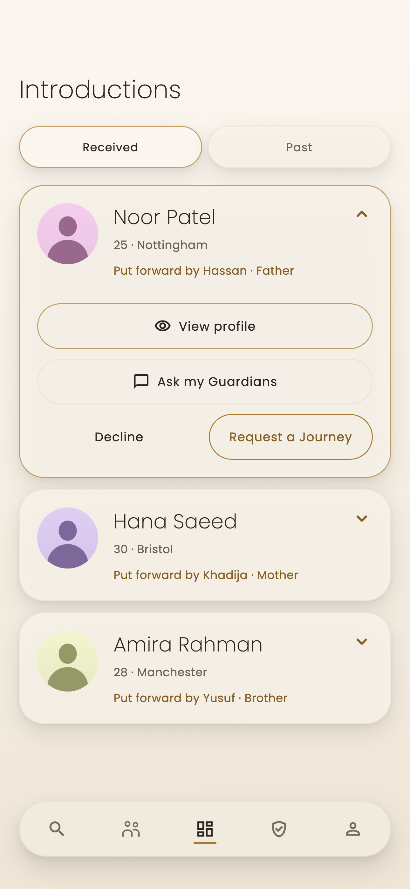
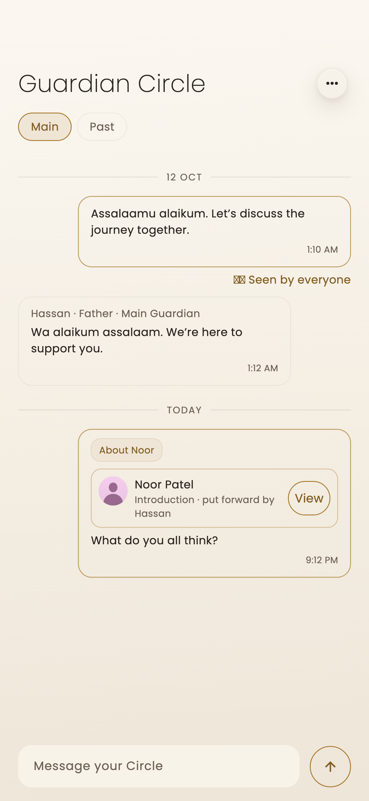
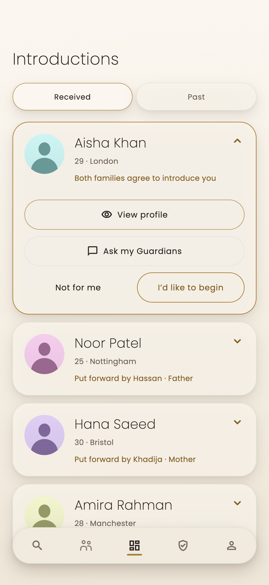
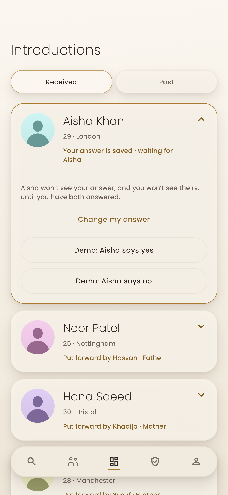
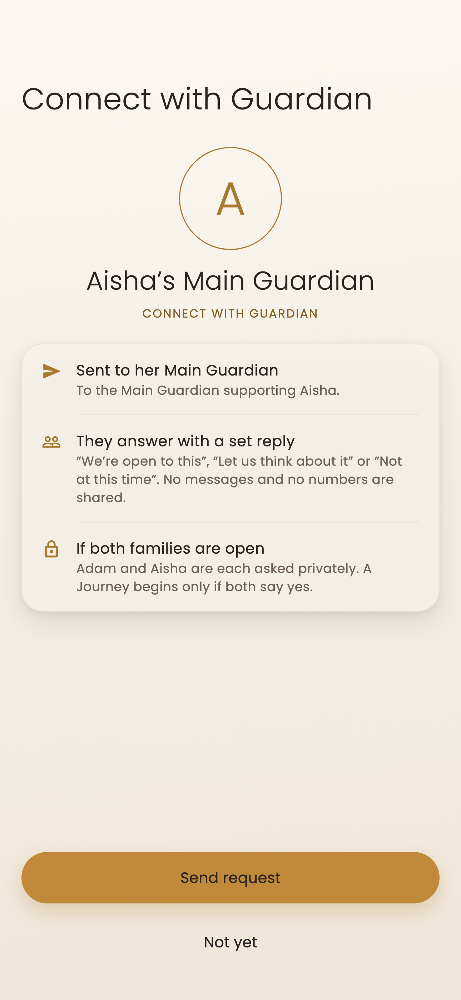
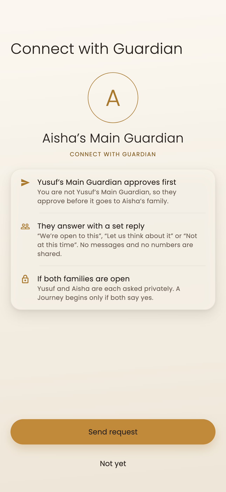
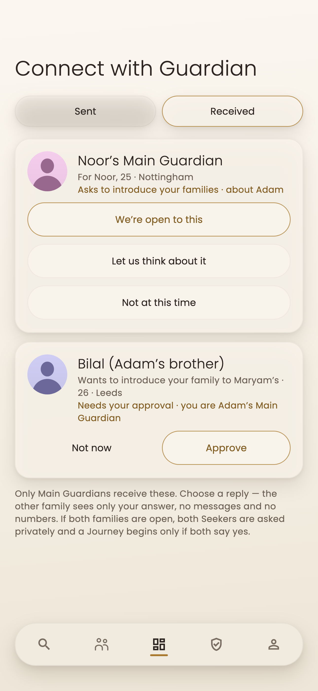
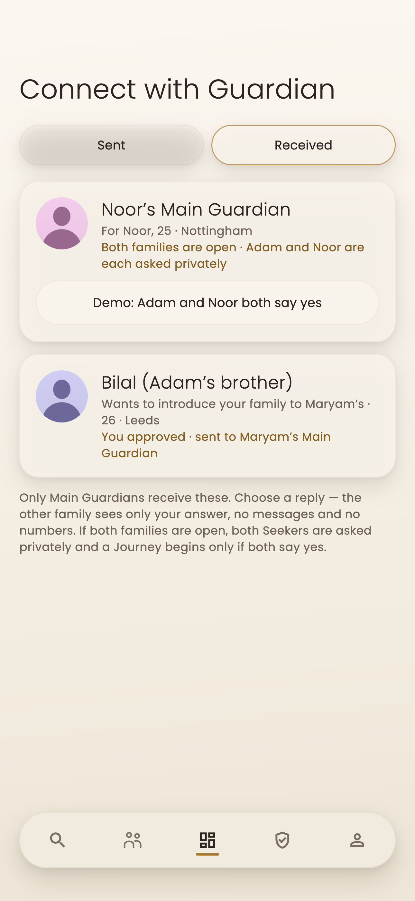

# Line147 approved master and actual whole page

All exact differences are described in VISUAL_COMPARISON.md. No full MATCH is claimed. Original image pixels are unchanged.

| Approved master | Actual whole page |
| --- | --- |
|  |  |
|  |  |
|  |  |
|  |  |
|  |  |
|  |  |
|  |  |
|  |  |
|  |  |
|  |  |
|  |  |
|  |  |
|  |  |
|  |  |
|  |  |
