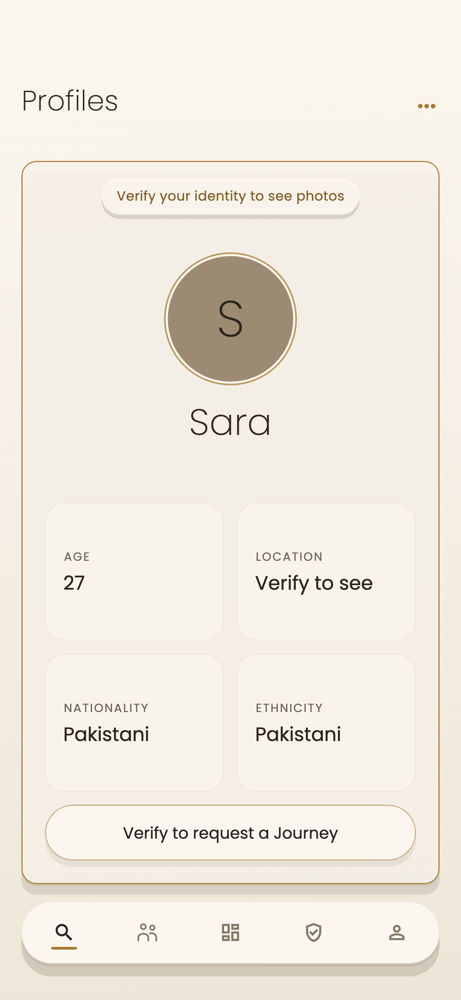

# Line 127 — SIGN_UP V2 — 24 Nov 2026

**State:** local gate passed in the Founder sample preview; commit receipt pending. **Live: no.**

**Built from:** `SIGN_UP/BRIEFS/BUILD_BRIEF_2026-11-22_V2.md`, `RECORD/SIGN_UP_SPEC_CURRENT_VERSION_V2.md`, `RECORD/LOCK_RECORD.md`, masters s31–s35, and answered QUESTIONS 198/201. The initial start pack was 18,791 bytes; the Q198 resume pack was 19,846 bytes. The full named brief/spec/masters were read. The first fresh conversation began on 24 Nov; its exact HH:MM is unavailable after the Q198/Q201 parks. Count-only usage is unavailable in this resumed agent.

**Built:** the old unverified gate is retired. Profiles hide peer surnames/towns, blur peer photo frames at sigma 14 and show the exact verify pill; the details card routes Verify to request to the local identity check. Q201 keeps navigation on photo pages but no request button there. Unverified people are excluded from public sample candidates. Guardian tab and setup show verify-first Add cards with no code/share; Guardian Network shows initial, no town, and Verify to introduce/connect. An unverified Guardian's link name stays pending until verification. Own photos remain clear. The Network's triangle and check are drawn so the test font cannot substitute boxes.

**Checks:** protected focused suite 63 passed; protected Guardian Network monogram/200% text and unverified focused suite 9 passed; s31–s35 capture run 50 passed at 430 × 932. Focused rendered-text audit of s31–s35 measured 51 visible runs, 34,747 painted pixels, zero failures; five audit JSON files are retained here. Protected whole-project analyzer clean. Protected ordinary regression **7,892 passed / 206 skipped / zero failures in 7m47s**, including line132's disjoint two-file edit, which this line does not commit. `git diff --check`: clean. The four full audit settings are hosted reporting under line 143; no local full audit. The capture runner initially failed because its output directory was absent; after creating it, the same capture suite passed. A first icon renderer overran the 200% Network row; the wrapped drawn mark corrected it and focused tests passed. The first ordinary run found one obsolete text-glyph assertion; its updated focused test passed and the second full run passed.

| Locked master | Built Founder preview |
|---|---|
|  |  |
|  |  |

The other pairs are s32–s34 in this folder and `CAPTURE_PAIRS.json` records all five hashes. The contracted content, privacy treatment, actions and navigation match. Pixel parity is not claimed: shared card/shadow metrics and the sample notification count differ from the prototype fixture. The s34 missing-glyph difference was fixed and recaptured.

**Boundaries and handover:** no server, native build, phone install, payment, migration, dependency or version change. Fable owns the live privacy/authorization contract (OA-ZYRA-381); OA-ZYRA-317 holds real integration. ZYRA Claude independently compares the pictures; Fable verifies the documents; Founder approval is separate. The prior line121 as-built record is updated with the V2 current state. The retired gate source moved to `~/_to_delete/LINE127_OLD_GATE_2026-11-24_0650UTC/`.

**Commit and public checks:** PENDING — stage only line127 files, excluding line132's concurrent wali screen/test edit. A secret scan, private-material review, roadmap/release check, wording check and README check are required before push.
